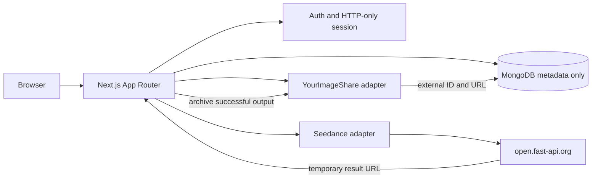

# Seedance Studio

> **AI model:** GPT-6 by OpenAI  
> **Created by:** OpenAI GPT-6 agent  
> **Project owner:** Fadil Muhammed  
> **Delivery branch:** `CHATGPT`

A full-stack, responsive AI video creation workspace combining Seedance generation, a chat-first prompt experience, multi-provider credential management, project/history organization and external media storage.

## Get the full source

The complete application source is directly downloadable as [`release/studioarena-source.tar.xz`](./release/studioarena-source.tar.xz). You can download that archive from this branch, or clone the branch and extract it:

```bash
git clone --branch CHATGPT https://github.com/fadilp5x/STUDIOARENA.git
cd STUDIOARENA
tar -xJf release/studioarena-source.tar.xz
cd studioarena
cp .env.example .env
npm install
npm run dev
```

An optional assembly script and six text-safe archive parts remain under `release/` as a fallback. Reconstruct the archive with `sh release/assemble.sh` if needed. Neither method requires an application API key.

## Features in this delivery

- **Studio:** text-to-video, image-to-video, video-to-video, audio-driven and multi-modal workflows; prompt editor; reference roles; resolution, aspect ratio, duration/frame count, audio, watermark, camera-fixed, seed, output format and advanced settings.
- **Chat previews:** conversational prompt workflow, attachment previews for uploaded images/videos, generation status, generated video preview/playback and download actions.
- **Seedance:** asynchronous task creation and polling, upstream history, status display, completed-task deletion, and asset registration.
- **Connections:** multiple named API profiles, active/default switching, encrypted credentials, masked display and connectivity testing.
- **YourImageShare:** external image/video uploads, including chunked upload support. MongoDB stores metadata and external media references, not uploaded binary content.
- **Assets / Projects / History:** ownership-aware metadata, project association, asset references and task records.
- **Responsive UI:** desktop, tablet and mobile layouts with touch-friendly controls.
- **Backend:** Next.js App Router API routes, MongoDB/Mongoose metadata models, password hashing, HTTP-only session cookies, encrypted provider credentials, request validation and basic rate limiting.

## Media storage policy

**Uploaded image and video binaries are not written to MongoDB or GridFS.** The backend forwards media to YourImageShare. MongoDB only keeps references and metadata such as external media ID, URL, file name, MIME type, size, dimensions, owner, and related task/project/chat records.

YourImageShare uploads are currently requested as unlisted. Unlisted does not mean private: a person who obtains the direct URL may be able to access the media. Do not upload confidential media until you have reviewed the provider's access controls and retention behavior.

The supplied YourImageShare documentation covers image/video upload; audio references therefore use a public URL or existing asset reference. The YourImageShare API key provided in chat is intentionally not included. Rotate that credential and place a replacement only in the server environment.

## Architecture



## Technology

- Next.js 15 App Router, React 19 and TypeScript
- MongoDB + Mongoose for structured metadata
- AES-256-GCM encryption for API credential secrets
- bcrypt password hashing and JWT-backed HTTP-only session cookies
- Seedance-compatible REST task gateway
- YourImageShare image/video API
- Responsive CSS and Lucide icons

## Environment configuration

Copy `.env.example` to `.env`. Set these values in the server environment:

| Variable | Purpose |
|---|---|
| `MONGODB_URI` | MongoDB connection string |
| `JWT_SECRET` | Session signing secret |
| `APP_ENCRYPTION_KEY` | 64-character hex key for AES-256-GCM |
| `YOURIMAGESHARE_API_KEY` | YourImageShare key (server only) |
| `SEEDANCE_BASE_URL` | Defaults to `https://open.fast-api.org` |
| `SEEDANCE_API_KEY` | Optional server-side Seedance credential |
| `ALLOW_PUBLIC_REGISTRATION` | Registration toggle |

Generate an encryption key with:

```bash
openssl rand -hex 32
```

Never put secrets in `NEXT_PUBLIC_*` variables, browser storage, source files, screenshots or commits. API keys stored by the application are encrypted server-side. Use a managed secrets service for production deployments.

## Seedance API

Base URL: `https://open.fast-api.org`

| Operation | Endpoint |
|---|---|
| Create generation | `POST /api/v3/contents/generations/tasks` |
| Get task | `GET /api/v3/contents/generations/tasks/{id}` |
| List tasks | `GET /api/v3/contents/generations/tasks` |
| Delete completed task | `DELETE /api/v3/contents/generations/tasks/{id}` |
| Create asset group | `POST /?Action=CreateAssetGroup&Version=2024-01-01` |
| Create asset | `POST /?Action=CreateAsset&Version=2024-01-01` |
| Get/list/update/delete assets | Asset RPC actions documented in `docs/API-INTEGRATION.md` |

Known upstream constraints:
- `duration` and `frames` are mutually exclusive.
- Draft mode is not supported by the supplied gateway.
- Queued/running tasks cannot be cancelled through the documented API.
- Task lookup is limited to the most recent seven days.
- Generated video URLs expire after 24 hours. The app attempts to archive successful outputs in YourImageShare before expiry.

## YourImageShare API

- Base URL: `https://yourimageshare.com/api`
- Auth header: `X-API-Key`
- Standard upload: `POST /` using multipart field `uploads`
- Chunked upload: `POST /chunk` with `upload_id`, `index`, `total` and `chunk`
- Listing and deletion operations are described in `docs/API-INTEGRATION.md`.

The implementation uses a 200 MB application upload limit and chunking for larger files. The provider may enforce additional account- or plan-level limits.

## API routes

| Route | Responsibility |
|---|---|
| `/api/health` | Database readiness |
| `/api/auth/*` | Register, login, logout and current user |
| `/api/connections` | List/add encrypted API connections |
| `/api/connections/:id` | Activate, disable, default, rename or delete connection |
| `/api/connections/:id/test` | Test supported provider connectivity |
| `/api/uploads` | Upload externally and list metadata |
| `/api/uploads/:id` | Delete external media and metadata |
| `/api/uploads/:id/sync` | Register uploaded reference in Seedance Assets |
| `/api/generations` | Submit/list generations |
| `/api/generations/:id` | Poll/archive result or delete completed task |
| `/api/conversations` | List/create chat threads |
| `/api/projects` | List/create projects |

## Provider adapters

Seedance is the implemented video generation adapter. YourImageShare is the implemented media-storage adapter. A saved credential for another provider does not make that provider automatically compatible: each additional provider needs an adapter that maps its model catalog, request schema, polling lifecycle, output URLs and error behavior to the internal provider contract.

## Development commands

```bash
npm run dev
npm run typecheck
npm run build
npm start
```

## Production hardening checklist

1. Configure HTTPS, a strict CSP, secure headers, request-size limits and a production secrets manager.
2. Disable public registration after creating the first owner account.
3. Use a durable worker/queue for polling and archiving tasks; the current polling experience is tied to the active Studio session.
4. Replace the included per-process rate limiter with Redis or an edge/platform limiter for multi-instance deployments.
5. Add account verification, password reset, media retention/deletion controls, upload scanning, robust retries, observability and log redaction.
6. Verify YourImageShare's access controls, retention policies, quotas and terms before storing sensitive media.
7. Run the production dependency installation, typecheck, build and live integration tests in your deployment environment.

## Validation status

The source snapshot was scanned for obvious hardcoded credential patterns and parsed for TypeScript/TSX syntax. A complete dependency-based typecheck, production build and live-provider integration test were **not verified** in the original build environment because dependency installation timed out. Treat this as a working implementation foundation, not a production-certified release.

## License

MIT. See [LICENSE](./LICENSE).